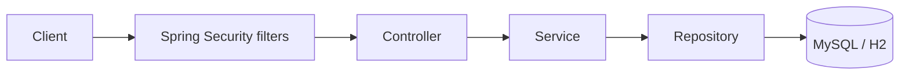

# Moo Twitter Backend

Moo is a Spring Boot backend for a Twitter-style social network. It provides
versioned REST APIs for users, posts, follows, likes, replies, hashtags, search,
and JWT authentication.

- :material-rocket-launch: **Run Moo**

    Install the prerequisites and start the API locally or with Docker.

    [Get started](getting-started/README.md)

- :material-api: **Integrate with the API**

    Learn the JWT and CSRF flow, endpoint contracts, and response models.

    [Explore the API](api/README.md)

- :material-sitemap: **Understand the design**

    Follow requests through the application and inspect the persistence model.

    [Read the architecture](architecture/README.md)

- :material-source-pull: **Contribute**

    Find the focused workflow for issues, branches, tests, and pull requests.

    [Start contributing](contributing/README.md)

## At a glance

- Java 25 and Spring Boot 4.1
- Spring MVC, Spring Security, and Spring Data JPA
- MySQL in development and production; H2 for tests
- JWT access tokens with rotating refresh tokens
- CSRF double-submit protection for state-changing requests
- OpenAPI, Prometheus metrics, OpenTelemetry, JaCoCo, Sonar, and CodeQL

## Request flow

The project keeps transport concerns in controllers, business rules in
services, and persistence in repositories. API consumers receive model records,
not JPA entities.

## Documentation map

| Section | What you will find |
| --- | --- |
| [Getting started](getting-started/README.md) | Installation, profiles, configuration, and local development |
| [Architecture](architecture/README.md) | Request flow, technology choices, security, and persistence |
| [API](api/README.md) | Authentication, endpoints, models, examples, and generated reference |
| [Quality](quality.md) | Tests, coverage, formatting, analysis, and CI |
| [Contributing](contributing/README.md) | Contribution workflow, issues, and reviews |
| [Project](project/README.md) | Planning, releases, support, and community resources |

## Useful links

- [Source repository](https://github.com/ohbus/twitter-backend-java)
- [Open issues](https://github.com/ohbus/twitter-backend-java/issues)
- [Contribution guidelines](https://github.com/ohbus/twitter-backend-java/blob/master/CONTRIBUTING.md)
- [Code of conduct](https://github.com/ohbus/twitter-backend-java/blob/master/CODE_OF_CONDUCT.md)
- [License](https://github.com/ohbus/twitter-backend-java/blob/master/LICENSE)
