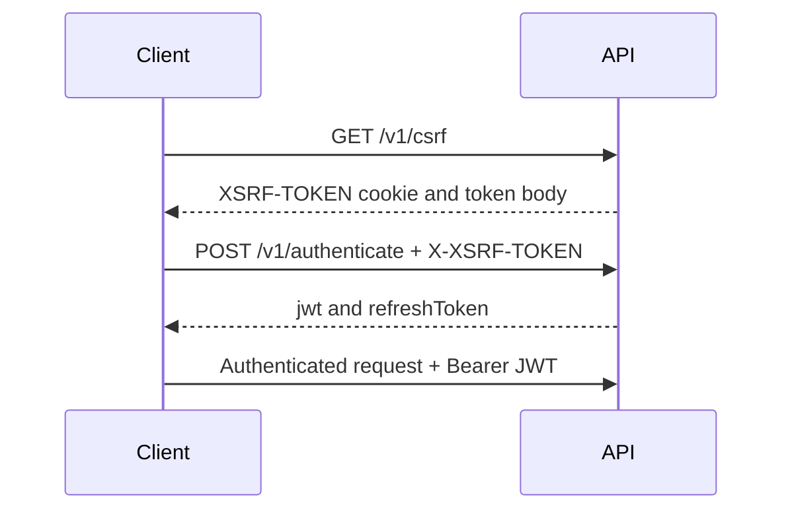

# Authentication and CSRF

Moo combines stateless JWT authentication with cookie-backed CSRF protection.
Even public POST endpoints require a CSRF token.

## Sign in flow

1. Call `GET /v1/csrf` and retain the `XSRF-TOKEN` cookie.
2. For POST, PUT, PATCH, and DELETE requests, copy that cookie value into the
   `X-XSRF-TOKEN` header.
3. Submit credentials to `POST /v1/authenticate`.
4. Send the returned JWT as a Bearer token on protected operations.
5. Rotate an expired access token with `POST /v1/refresh` and the refresh token.
6. Call `POST /v1/logout` to delete the current user refresh token.

Refresh tokens are rotated when used. Treat both token types as secrets and do
not place them in URLs or logs.
