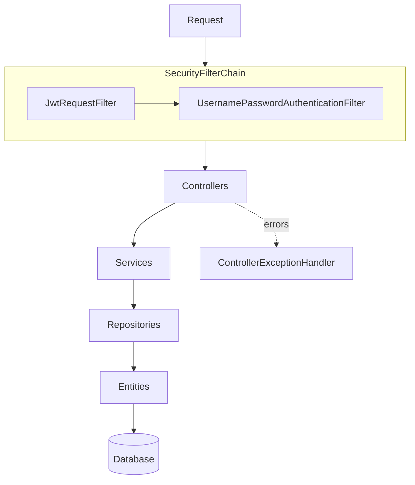

# Architecture

Moo is one Spring Boot application organized by responsibility. Controllers
own HTTP contracts, services own behavior, repositories own persistence, and
model records define the public API.

## Package responsibilities

| Package | Responsibility |
| --- | --- |
| `controller` | Versioned HTTP endpoints and validation |
| `service` | Business contracts and implementations |
| `repository` | Spring Data database access |
| `entity` | Internal JPA persistence state |
| `model` | Request and response records |
| `security` | JWT authentication and CSRF configuration |
| `config` | Framework integration and fallback errors |
| `exception` | API exception mapping |

Authenticated operations derive the current user from `Principal`; callers
cannot substitute another user ID. State-changing requests also pass Spring
Security CSRF validation.

## In this section

| Page | Focus |
| --- | --- |
| [Technology choices](technology.md) | Runtime, frameworks, persistence, observability, and quality tools |
| [Data model](data-model.md) | Users, posts, follows, likes, hashtags, and refresh tokens |
| [API architecture](../api/README.md) | Versioned HTTP contracts, authentication, and response models |
