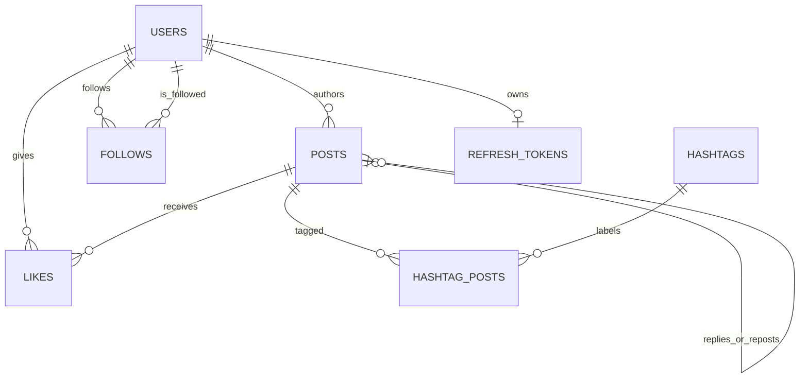

# Data model

## Main records

- `Users` stores identity, profile, password hash, counters, and verification.
- `Posts` stores up to 240 characters, media URLs, counters, author, reply and
  original-post references, hashtags, and mentions.
- `Follow` records a unique follower/following pair.
- `Likes` enforces one like per user and post. `HashtagPosts` indexes its
  hashtag and post relationships but does not enforce unique pairs.
- `RefreshToken` stores one rotating refresh token per user.

Entities stay internal. Controllers expose the records in `model`, preventing
persistence details and password hashes from leaking into API responses.
